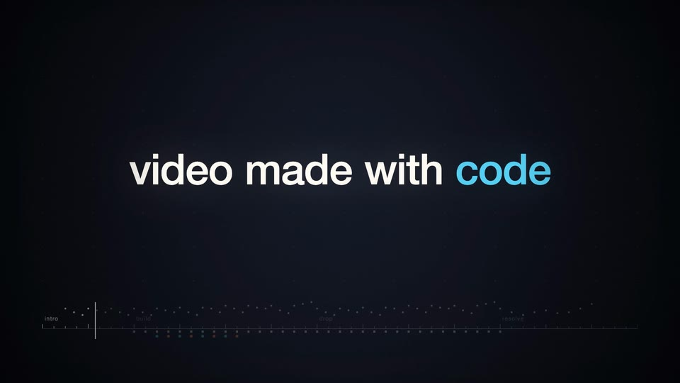
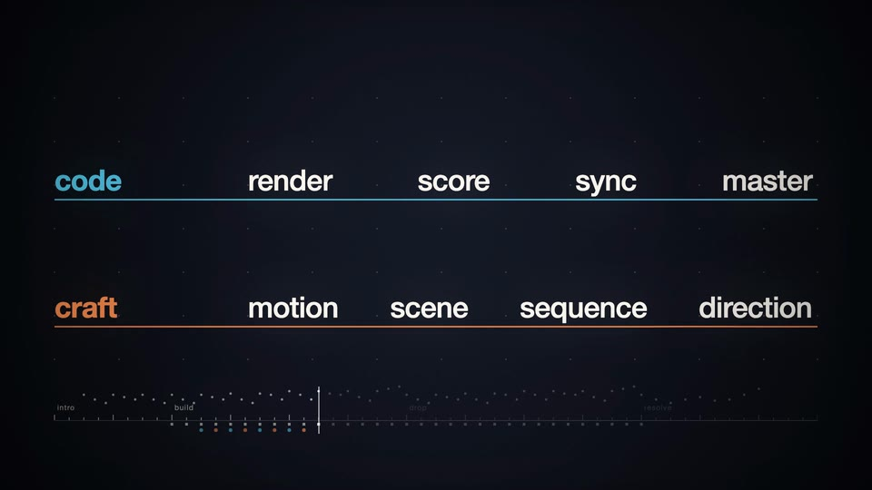
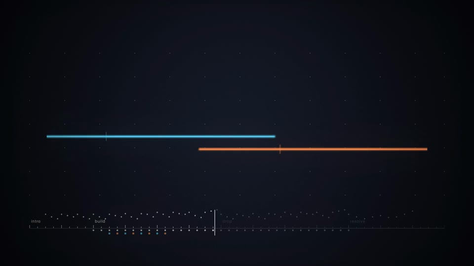

# Showcase: a trailer for this package

A 26-second trailer for video-knowhow, made with the techniques the two shelves describe. One page draws every frame from its time, one Node script writes the score from the same beat clock, and the render captures the page and muxes the mastered sound. It keeps the [starter](../starter/README.md)'s shape, so you can read it file by file against the starter and see what a fuller production adds.

Watch it: [the trailer on YouTube](https://youtu.be/02laS8NbEbA), rendered from this folder at commit `00c85f59`, with `prefs.js`.


## The piece

The score runs at 120 BPM in A minor, 52 beats at 30 fps (780 frames). Every picture event takes its time from what the score records in `score-events.json` (kicks, claps, the snare roll, hook notes, landings, stabs, chords, the riser) or from the section and gap times in `timeline.js` that the score also reads. `scene.js` and `post.js` type no event beat of their own.

| Section | Beats | Seconds | Sound | Picture |
| --- | --- | --- | --- | --- |
| Intro | 0–8 | 0–4 | A low drone and a plucked hook | "video made with code" one word per hook note, lowercase and unpunctuated like all the on-screen text |
| Build | 8–23.75 | 4–11.875 | Chords, a kick that opens from a low-pass, swung hats, offbeat bass to the end, bells, a snare roll and a riser | The shelves shoot out on the first two kicks; eight words fall onto the code and craft shelves on the bells; the shelves converge and the snare roll ticks onto them |
| Breath | 23.75–24 | 11.875–12 | Digital silence for a quarter beat | Black |
| Drop | 24–40 | 12–20 | Impact, full drums, 3-3-2 bass, supersaw stabs, a gliding lead, kick sidechain | The title lands; each stab lights the underline; the subtitle's two lines and the three kinds of page enter on stabs |
| Resolve | 40–52 | 20–26 | Pads, a quiet legato bass and a delayed pluck | The title steps back: "read the pages  run the code" |

| Intro | Shelves | Converge |
| --- | --- | --- |
|  |  |  |
| **Drop** | **Drop, full page** | **Resolve** |
|  |  |  |

Silent clips: [intro words](media/clip-intro-words.mp4), [landings on the shelves](media/clip-landings.mp4), [into the drop](media/clip-into-the-drop.mp4), [resolve](media/clip-resolve.mp4).

## Run it

You need Node 22.12 or later and an installed Chrome or Chromium. ffmpeg comes with `npm install` (ffmpeg-static).

```sh
npm install
export CHROME_PATH="/Applications/Google Chrome.app/Contents/MacOS/Google Chrome"   # macOS
npm run render        # score.wav and score-events.json, then out/showcase.mp4 (about 5 minutes on a laptop)
node render.js --master   # an upload master from the same score.wav: out/showcase-master.mp4
npm run preview       # live preview at http://localhost:8000/ (click for sound)
npm run media         # render, then the stills, clips and sound snippets in media/
npm run check         # a flash check of out/showcase.mp4
```

`render.js` takes the starter's options (`--frames a-b`, `--fps n`, `--out file`) and four more (`--help` prints them):

| Option | Default | Meaning |
| --- | --- | --- |
| `--samples n` | 16 | Motion-blur sub-frames per frame, spread over a half-frame shutter. 1 turns the blur off. |
| `--crf n` | 18 | H.264 quality: lower is better and larger. |
| `--abr rate` | `320k` | The AAC bit rate. |
| `--master` | off | An upload master, written to `out/showcase-master.mp4`: CRF 14 and the slow x264 speed setting. Only the video differs; the sound is the same mastered AAC at 320 kbit/s. |

The whole piece is encoded to AAC, measured, corrected to −14 LUFS under −1 dBTP, and checked again on the muxed file; a `--frames` slice keeps the score's level. The render needs the package's [samples](../samples/README.md) folder next to this one: `audio.js` and `delivery.js` load `master-loudness.js`, `loudness-gate.js`, `wav-writer.js` and `seeded-streams.js` from it.

## Files

| File | Part | What it holds |
| --- | --- | --- |
| `index.html` | Stage | The canvas `#c`, `window.draw(frame, samples)` with a 16-sample half-frame shutter, `window.ready`, and the preview loop. |
| `timeline.js` | Clock | Tempo, length, sections, the gap before the drop, the end curve `endGain` that sound and picture share, the delivery targets, conversions, `rng` and `hash`. |
| `tokens.js` | Tokens | Palette roles, the 120 px safe area, the 12-column grid, and the faces loaded before frame 0. |
| `prefs.js` | Preferences | The owner's current preferences over the base design: Helvetica Neue in place of the monospace face, each shelf's name leading its row instead of a small label above the line, with no counter, and no corner labels. Delete it and its script tag in `index.html` to render the base look. The stills and clips in `media/` are rendered with it. |
| `scene.js` | Scene | `scene(ctx, t, fps)`: background, score strip, corner labels, intro words, shelves, title and closing line. Event times come from `EV`. |
| `post.js` | Post | `post(ctx, t, fps)` on each averaged frame: bloom tied to the reverb's RT60, vignette, seeded grain, the fade in, the gap, the end curve. |
| `audio.js` | Sound | `renderScore(opts)`: the arrangement, buses, sends, sidechain and master. Writes `score.wav` (48 kHz, 24-bit) and `score-events.json`. |
| `voices.js` | Voices | Kick, clap, snare, hats, bass, supersaw, lead, pad, pluck, bell, riser, impact, crash, drone, room tone. |
| `dsp.js` | DSP | Filter, oscillator, string, reverb, delay, compressor and crossover building blocks. |
| `delivery.js` | Delivery | 16-bit with dither, AAC encoding measured and corrected on the encoded file, the delivery gate. |
| `render.js` | Render | Headless Chrome through puppeteer-core, PNG frames piped to ffmpeg, the AAC master muxed in, the gate. |
| `media.js` | Media | The stills, clips and snippets in `media/`. |
| `check.js` | Check | A flash check of the rendered video: flashes per second over the whole frame and 4×4 cells, the largest frame-to-frame change, saturated red. |
| `preview.js` | Preview | The starter's static server for the live preview. |

The page keeps the starter's contract (`#c`, `window.ready`, `window.draw(frame, samples)`) and changes four things. `render.js` hands the score's events to the page before its scripts run, as `window.SCORE_EVENTS` (a `file://` page cannot fetch); the preview fetches `score-events.json` instead. `draw` averages 16 sub-frames by default, where the starter averages 4; the preview draws 1. After the average, `post()` finishes each frame: bloom, vignette, grain, the gap and the end curve. `scene` and `post` take the render's frame rate, so the frame counter and grain follow `--fps`.

## Hear the contrasts

Two snippets are slices of the score at its own level. The three others are variants rendered by `renderScore` options. In an off/on pair each half is matched to −16 LUFS and both go through one limiter, so the difference you hear is the technique, not the volume. `media.js` encodes them with ffmpeg's native AAC encoder, so a second `npm run media` writes the same bytes.

- [Build into the drop](media/audio-build-into-drop.m4a): the snare roll and riser, the quarter-beat breath, then the impact.
- [The drop, mastered](media/audio-drop-mastered.m4a): five seconds of the delivered mix.
- [Drums alone](media/audio-drums-solo.m4a): kick, clap, swung hats and open hats in the drop, with their glue compression and parallel crush.
- [Sidechain off, then on](media/audio-sidechain-off-on.m4a): the bass and the chord bed alone, first steady, then ducked by the (unheard) kick: the pump.
- [Sends off, then on](media/audio-sends-off-on.m4a): the resolve's pluck and pads dry, then with their own reverb and dotted-eighth delay returns. In a solo only the soloed buses feed the returns; `solo` takes `'returns'` to let them through.

## Techniques and where they are

| Technique | File and function | Knowledge page |
| --- | --- | --- |
| One beat clock; the score records its events and the picture reads them | `timeline.js` (`T`); `audio.js` `renderScore` writes `score-events.json`; `index.html` hands it to `scene.js` as `EV` | [Audiovisual synchronization](../knowledge/Audiovisual%20synchronization.md) |
| Every frame and sample from its time, randomness from seeded streams | `timeline.js` `rng`, `hash`; `eventRng` from `seeded-streams.js` per event in `audio.js`; grain tiles in `post.js` | [Deterministic rendering](../knowledge/Deterministic%20rendering.md) |
| Half-frame shutter motion blur, eased and spring motion | `index.html` `draw`; `scene.js` `build`, `title` | [Time and motion](../knowledge/Time%20and%20motion.md), [Motion character](../../video-knowhow-craft/knowledge/Motion%20character.md) |
| Words on notes, a title on the downbeat, legible type | `scene.js` `intro`, `title`, `text` | [Typography in motion](../knowledge/Typography%20in%20motion.md), [Typographic events](../../video-knowhow-craft/knowledge/Typographic%20events.md) |
| Two shelves converge into one title | `scene.js` `build`, `title` | [Convergence](../../video-knowhow-craft/knowledge/Convergence.md), [Anticipation to title](../../video-knowhow-craft/cases/Anticipation%20to%20title.md) |
| Palette, grid and type defined once | `tokens.js` | [Visual identity and style](../theory/Visual%20identity%20and%20style.md), [Visual hierarchy and composition](../knowledge/Visual%20hierarchy%20and%20composition.md) |
| Bloom, vignette and grain | `post.js` `post` | [Visual identity and style](../theory/Visual%20identity%20and%20style.md) |
| Band-limited saws with detune | `dsp.js` `Saw` (PolyBLEP); `voices.js` `supersaw`, `lead` | [Audio synthesis](../knowledge/Audio%20synthesis.md), [Sound sources and voices](../knowledge/Sound%20sources%20and%20voices.md) |
| Plucked string | `dsp.js` `ksBuffer` (Karplus-Strong); `voices.js` `pluck` | [Sound sources and voices](../knowledge/Sound%20sources%20and%20voices.md) |
| Filtered bass with envelope and drive; kick, clap, snare, hats | `voices.js` `bass`, `kick`, `clap`, `snare`, `hat` | [Sound sources and voices](../knowledge/Sound%20sources%20and%20voices.md) |
| Swung, slightly loose hats | `audio.js` `renderScore` (`swing16`, 54 % swing, per-hit jitter) | [Groove and feel](../knowledge/Groove%20and%20feel.md) |
| Moving filters, glue and parallel compression, kick sidechain | `dsp.js` `SVF`, `compress`; `audio.js` `curve`, `duckEnv` | [Dynamics and spectral carving](../knowledge/Dynamics%20and%20spectral%20carving.md) |
| Reverb and tempo-synced delay on sends, cleared at the breath and raised 7 dB for the resolve | `dsp.js` `freeverb`, `pingpong`; `Bus.add` sends and the returns' `lift` in `audio.js` | [Space and delay](../knowledge/Space%20and%20delay.md) |
| A breath of silence before the drop; a gain arc across sections | `timeline.js` `GAP`, `endGain`; `audio.js` `Bus.add`, `arc` | [Musical development](../../video-knowhow-craft/knowledge/Musical%20development.md), [Density and rest](../../video-knowhow-craft/patterns/Density%20and%20rest.md) |
| Mono lows, an air shelf, bus compression, trim and limit | `audio.js` `renderScore` (master); `findTrim` from `master-loudness.js` | [Mastering and delivery](../knowledge/Mastering%20and%20delivery.md) |
| 16-bit with TPDF dither, AAC measured on the encoded file | `delivery.js` `wav16`, `encodeAac`; `gate` from `loudness-gate.js` | [Mastering and delivery](../knowledge/Mastering%20and%20delivery.md), [Capture and encoding](../knowledge/Capture%20and%20encoding.md) |
| BT.709 video range, tagged | `render.js` | [Delivery and color](../knowledge/Delivery%20and%20color.md) |
| Flash limits: no full-frame flashes, the brightest change is the cut at the drop, kick pulses stay small, no saturated red | `post.js` `post` (bloom amount); `scene.js` `background` (rings, grid pulse); `check.js` measures it | [Accessibility and perception](../knowledge/Accessibility%20and%20perception.md) |
| Small media for review, made from code | `media.js` | [Verification](../knowledge/Verification.md) |

## What has been measured

**Checked (one machine):** on macOS 26.7.1 with Chrome 155, Node 24, ffmpeg-static 5.3.0 (ffmpeg 6.0), and puppeteer-core 25.13.0, two runs of `npm run render` gave identical video framemd5 lists for all 780 frames and a byte-identical `score.wav` and `score-events.json`. On macOS the AAC step uses Apple's encoder (`aac_at`); other systems fall back to ffmpeg's `aac`. Apple's output can vary from run to run (its true peak has read −1.7 and −1.8 dBTP), so a whole `out/showcase.mp4` is not promised to repeat byte for byte. Each run took about 4.5 minutes for the frames at 16 sub-frames. Two runs of `node media.js` wrote byte-identical files to `media/` (0.8 MB in all).

**Checked (one machine):** ffmpeg's ebur128 filter on the encoded AAC in `out/showcase.mp4` reads −14.0 LUFS integrated and −1.7 dBTP true peak; `out/showcase-master.mp4` (CRF 14) reads the same. On the decoded audio the sections measure about −21.2 LUFS (intro), −15.3 (build), −11.3 (drop) and −18.1 (resolve), with no samples at full scale. `score.wav` holds digital zero through the breath; the AAC codec leaves a residue there below −36 dBFS peak. Each half of the off/on snippets in `media/` reads −16.0 to −16.2 LUFS.

**Checked (one machine):** `npm run check` over all 780 frames of `out/showcase.mp4` found no full-frame flashes; in the worst of the 16 cells no second holds more than one transition, which is half a flash; the largest frame-to-frame change in mean luminance is 0.064 (on a 0–1 scale), at the cut into the drop, and no pixel is saturated red (red at least 64 of 255 and at least 80 % of R + G + B). The method follows [Accessibility and perception](../knowledge/Accessibility%20and%20perception.md): relative luminance in linear light, transitions of 0.1 or more whose darker end is below 0.8, and a fail above three flashes in any second.

**Checked (one machine):** `node render.js --fps 60 --frames 240-246` drew the frame counter as 240 to 245, the 60 fps frame numbers (in the base look; `prefs.js` hides the counter).
